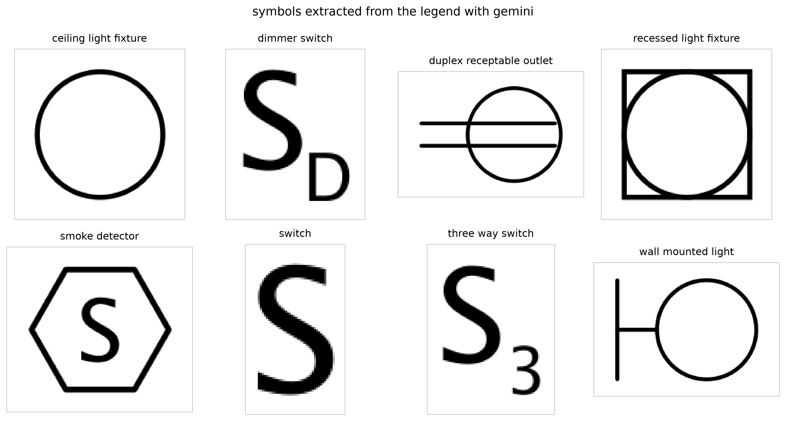
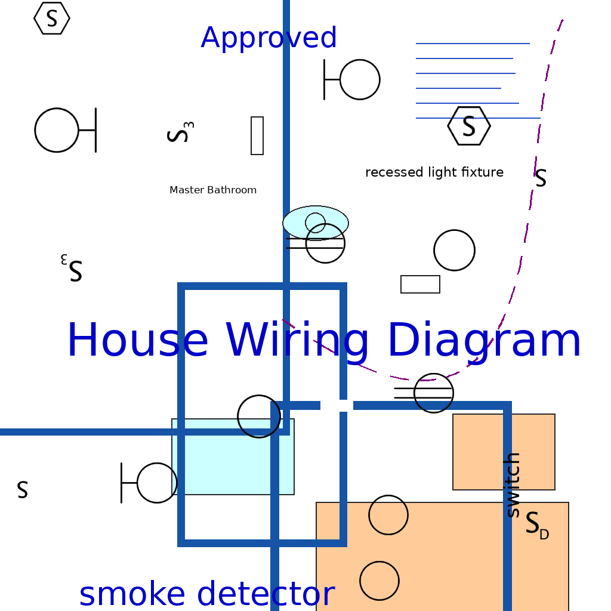
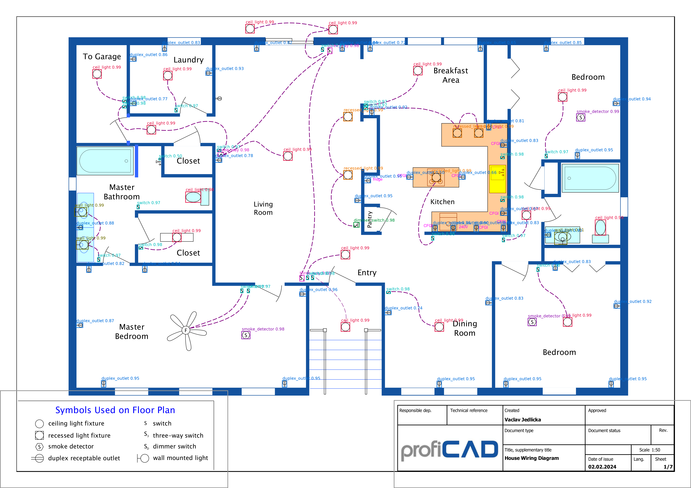

# Electrical-Symbol-Detector-for-Construction-Plans || YOLOv8
Detects and counts electrical symbols on architectural floor plans using **YOLOv8**, with a review interface for correcting the results.
## What it does

Takes a floor plan image, finds every electrical symbol on it, and produces a
count by type. The output can be reviewed and corrected in the browser before
export.

*Initially, I selected the symbols from the plan and cut them separately. Later, this part was done with a single prompt with the gemini-3.5-flash model.*
```
This is the legend of a construction drawing. Each row has a small
symbol drawing on the left and its name in words on the right.

Detect every symbol drawing. For each one give the name exactly as written in the
legend, and a box around the SYMBOL DRAWING ONLY, not the words next to it.
Skip the legend title. Do not invent rows.
The box_2d should be [ymin, xmin, ymax, xmax] normalized to 0-1000.
```
Floor Plan Image Demo:


Gemini Crop Demo (Just from prompt and the cropped legends box ):



## Approach

**No hand labelling.** Symbols are cropped from the plan's own legend, so the
training data comes from the drawing itself. A synthetic generator pastes those
symbols onto procedurally drawn plan pages, which means every label is exact and
free.


**Hard negatives from real failures.** The synthetic backgrounds contain room text,
walls, dashed wiring, fixtures and fills, added in response to the false positives
the model actually produced.

Train Images Demo:


**It is important to note that I added a lot of artifacts (Random writing, shapes, lines, etc.) to match the actual construction plan. Without these artifacts, a model was trained also. For obvious reasons, it worked poorly when applied to the original plan, as the data was very different.**

**Tiled inference.** Symbols are tiny relative to the sheet, so the plan is
processed in overlapping tiles and the detections are merged, with boxes cut by
inner tile edges discarded.

**Validation against ground truth in the document.** The plan carries its own bill
of materials, which is parsed and compared against the predicted counts.

Final detected result:


## Review interface

A FastAPI service with a hand-built front end. Detections are drawn over the plan
as filterable overlays, listed in a schedule grouped by type, and can be
reclassified, deleted, or added by hand. New symbol types can be defined by the
user. Corrections are exported as JSON.

Demo Interface


You can run the demo with this command:
```
python app_2.py
```
## Stack

YOLOv8, OpenCV, PyMuPDF, FastAPI, gemini-3.5-flash
